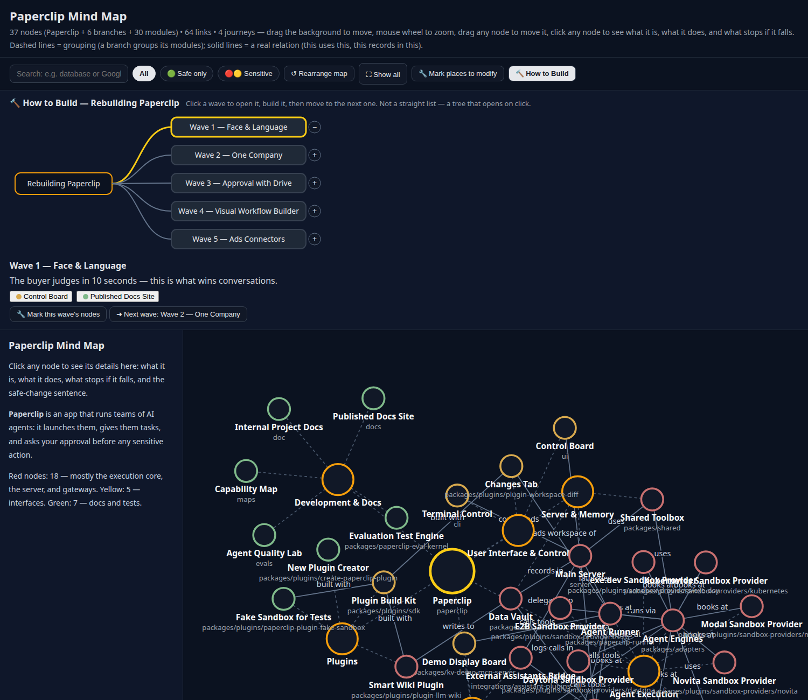

<h1 align="center">MapMyCode</h1>

<p align="center">
  <strong>An interactive map of any codebase, written in plain human language — for the ordinary person, not just for programmers.</strong>
  <br />
  <em>Open any project, click any part, and understand what it does and what happens if you change it — without reading a single line of code.</em>
</p>

<p align="center">
  <strong>Origin: MapMyCode started as a fork of <a href="https://github.com/Egonex-AI/Understand-Anything">Understand-Anything by Egonex-AI</a> — open source, MIT license, kept intact.</strong>
  <br />
  <em>We kept its analysis engine and rebuilt what a person sees for the ordinary person: plain-language nodes (real file name on top, always), any conversation language, a red/yellow/green risk radar, a feature view, an intent box that fills the safe-change prompt, and a story tour. The Paperclip demo below also shows mark-to-modify and a How to Build guide.</em>
  <br />
  <em>Works with Claude Code, Codex, Cursor, Copilot, Gemini CLI, and more.</em>
</p>

<p align="center">
  <a href="#-quick-start"></a>
  <a href="https://github.com/ellsimohammed8-prog/MapMyCode/blob/main/LICENSE"></a>
  <a href="https://docs.anthropic.com/en/docs/claude-code"></a>
  <a href="#codex"></a>
  <a href="#vs-code--github-copilot"></a>
  <a href="#copilot-cli"></a>
  <a href="#gemini-cli"></a>
  <a href="#opencode"></a>
  <a href="#mistral-vibe-cli"></a>
  <a href="#trae"></a>
</p>

<p align="center">
  
</p>

## 🗺️ See it: a real map, in plain English

This is a real map of [Paperclip](https://github.com/paperclipai/paperclip) — a multi-agent platform — built with the new method: every node shows its real file name on top, a plain-language name, what it does, and what stops if it falls. Red nodes are sensitive (touching them can break core features); green nodes are safe to change.

New: the **How to Build** box at the top walks you through rebuilding the app wave by wave — click a wave to open it, mark its nodes, then move to the next one. And **Mark places to modify** collects your own modification plan from any node.


👉 [Open the interactive map](examples/paperclip-mindmap.html) — drag to move, scroll to zoom, click any node for its details, use **Mark places to modify** to build your modification plan, or open **How to Build** to follow the rebuild path wave by wave.

---

**You want to build with AI, but you cannot read code. You open a project and see files you do not understand.**

This fork turns any codebase into an interactive map written in plain human language. It is built for beginners and ordinary people who direct an AI to build and change software — not for programmers. Open any project, click any part, and the map tells you what it is, what it does inside the app, and what will happen if you change it — before you tell the AI to change anything.

> **The goal isn't a graph that impresses you with how complex your codebase is — it's a map that teaches an ordinary person how every piece works, in words they already understand.**

**What each node shows:**
- The **real file name on top, always** — real names are never hidden, so you learn them as you explore.
- A **plain-language name** underneath it, like a job title ("the cashier" for a payment file).
- **What the file is**, in one plain sentence, and **its role inside the app**.
- **What happens if you change it** — the visible behavior that changes and what breaks, specific to that file.
- A **ready sentence to copy and paste to an AI** to change that file safely, naming what to change and what must not change.

**What is built, and what is still roadmap:**

Built:
- Any conversation language for generated content, with no fixed language list, plus an Arabic dashboard UI and RTL layout (slice 1).
- Plain-language nodes: every file node carries its plain name, role, change consequence, and safe-change sentence, shown first in the dashboard with technical details tucked away (slice 2).
- Pipeline questions that fill every node: feature purpose, functional risk, and a risk level (🟢🟡🔴), plus a safe AI prompt in XML the user only completes with their change (step 2).
- A red/yellow/green risk radar: colored node borders and badges, and a risk filter that shows safe or sensitive files only (step 3).
- A feature view: tour steps as concrete feature cards in journey order, with every file covered (step 4).
- An intent box: ask in plain words, get matching nodes and a filled safe-change prompt ready to copy (step 5).
- A story tour player: a guided walk through the app with a red alert card on every sensitive station (step 6).
- A live demo: a real Paperclip map in plain English with mark-to-modify and a How to Build guide (demo).

Still to do:
- A visual rebrand of the dashboard itself (logo and images) to match the new name.
- A real generation run through the plugin itself, and a test with an actual ordinary person.
- Rebuilt translated READMEs to match the new text.

---

## ✨ Features

> [!NOTE]
> **Want to skip the reading?** Try the [Paperclip demo](examples/paperclip-mindmap.html) below — a real map in plain English you can open right in your browser.

### Explore the map in plain language

Navigate your project as an interactive map — every file is a node you can click, search, and explore. Select any node to see its plain-language name, what it does, what happens if you change it, and the sentence to paste to an AI to change it safely. The real file name always stays on top.

### Understand business logic

Switch to the domain view and see how your code maps to real business processes — domains, flows, and steps laid out as a horizontal graph.

### Analyze knowledge bases

Point `/understand-knowledge` at a [Karpathy-pattern LLM wiki](https://gist.github.com/karpathy/442a6bf555914893e9891c11519de94f) and get a force-directed knowledge graph with community clustering. The deterministic parser extracts wikilinks and categories from `index.md`, then LLM agents discover implicit relationships, extract entities, and surface claims — turning your wiki into a navigable graph of interconnected ideas.

<table>
  <tr>
    <td width="50%" valign="top">
      <h3>🧭 Guided Tours</h3>
      <p>Auto-generated walkthroughs of the architecture, ordered by dependency. Learn the codebase in the right order.</p>
    </td>
    <td width="50%" valign="top">
      <h3>🔍 Fuzzy & Semantic Search</h3>
      <p>Find anything by name or by meaning. Search "which parts handle auth?" and get relevant results across the graph.</p>
    </td>
  </tr>
  <tr>
    <td width="50%" valign="top">
      <h3>📊 Diff Impact Analysis</h3>
      <p>See which parts of the system your changes affect before you commit. Understand ripple effects across the codebase.</p>
    </td>
    <td width="50%" valign="top">
      <h3>🎭 Persona-Adaptive UI</h3>
      <p>The dashboard adjusts its detail level based on who you are — junior dev, PM, or power user.</p>
    </td>
  </tr>
  <tr>
    <td width="50%" valign="top">
      <h3>🏗️ Layer Visualization</h3>
      <p>Automatic grouping by architectural layer — API, Service, Data, UI, Utility — with color-coded legend.</p>
    </td>
    <td width="50%" valign="top">
      <h3>📚 Language Concepts</h3>
      <p>12 programming patterns (generics, closures, decorators, etc.) explained in context wherever they appear.</p>
    </td>
  </tr>
</table>

---

## 🚀 Quick Start

### 1. Install the plugin

```bash
/plugin marketplace add ellsimohammed8-prog/MapMyCode
/plugin install understand-anything
```

> This installs this fork. The upstream project installs with `/plugin marketplace add Egonex-AI/Understand-Anything` instead.

> **Using a local model?** For privacy or enterprise setups, point your platform at a local model provider such as [Ollama](https://docs.ollama.com/integrations) — follow their integration guide to change the model provider.

### 2. Analyze your codebase

```bash
/understand
```

A multi-agent pipeline scans your project, extracts every file, function, class, and dependency, then builds a knowledge graph saved to `.ua/knowledge-graph.json`. (Projects that already have a `.understand-anything/` directory keep using it — it stays the data directory when present, so nothing needs migrating.)

> **Heads up on token usage:** The initial `/understand` analyzes your whole codebase and can consume a significant number of tokens on large projects. We recommend running it on a token plan / subscription, or using a local model (see above) for initialization. Subsequent runs are incremental by default — only changed files are re-analyzed — so they use far fewer tokens.

**Localized output:** Use `--language` to generate content in your preferred language:

```bash
# Generate Chinese content (知识图节点描述和 Dashboard UI)
/understand --language zh

# Supported languages: any ISO 639-1 code or friendly name — there is no fixed list (en is the default). The dashboard UI ships translated dictionaries for en, zh, zh-TW, ja, ko, ru, vi, ar, and switches to RTL layout for RTL languages (ar, fa, he, ur); other codes fall back to English UI text while generated content is still produced in the requested language.
```

On the **first run** in a project — when you don't pass `--language` and no language is stored yet — `/understand` detects the language you're conversing in. If it isn't English, it asks you to confirm (or override) before generating; English conversations are unaffected. Your choice is saved to `.ua/config.json` and reused on every later run.

The `--language` parameter affects:
- Node summaries and descriptions in the knowledge graph
- Plain-language node fields (plain name, role, change consequence, safe-change sentence)
- Dashboard UI labels, buttons, and tooltips
- Guided tour explanations

### 3. Explore the dashboard

```bash
/understand-dashboard
```

An interactive web dashboard opens with your codebase visualized as a graph — color-coded by architectural layer, searchable, and clickable. Select any node to see its code, relationships, and a plain-English explanation.

### 4. Keep learning

```bash
# Ask anything about the codebase
/understand-chat How does the payment flow work?

# Analyze impact of your current changes
/understand-diff

# Deep-dive into a specific file or function
/understand-explain src/auth/login.ts

# Generate an onboarding guide for new team members
/understand-onboard

# Extract business domain knowledge (domains, flows, steps)
/understand-domain

# Analyze a Karpathy-pattern LLM wiki knowledge base
/understand-knowledge ~/path/to/wiki

# Re-run anytime — incremental by default (only re-analyzes changed files)
/understand

# Auto-update on every commit via a post-commit hook
/understand --auto-update

# Scope to a subdirectory (for huge monorepos)
/understand src/frontend
```

---

## 🌐 Multi-Platform Installation

MapMyCode works across multiple AI coding platforms.

### Claude Code (Native)

```bash
/plugin marketplace add ellsimohammed8-prog/MapMyCode
/plugin install understand-anything
```

> This installs this fork. The upstream project installs with `/plugin marketplace add Egonex-AI/Understand-Anything` instead.


### One-line install (Codex / OpenCode / OpenClaw / Antigravity / Gemini CLI / Pi Agent / Vibe CLI / VS Code Copilot / Hermes / Cline / KIMI CLI / Trae / Nanobot / Kiro)


**macOS / Linux:**
```bash
curl -fsSL https://raw.githubusercontent.com/ellsimohammed8-prog/MapMyCode/main/install.sh | bash
# or skip the prompt by passing the platform:
curl -fsSL https://raw.githubusercontent.com/ellsimohammed8-prog/MapMyCode/main/install.sh | bash -s codex
```

**Windows (PowerShell):**
```powershell
iwr -useb https://raw.githubusercontent.com/ellsimohammed8-prog/MapMyCode/main/install.ps1 | iex
```

The installer clones the repo to `~/.understand-anything/repo` and creates the right symlinks for the chosen platform. Restart your CLI/IDE afterwards.

> **Note on invoking skills:** the invocation prefix differs per platform. Most platforms use slash commands (`/understand`), but **Codex uses `$` instead** — type `$understand`, not `/understand`. If neither prefix is recognized on your platform, just ask in plain language: *"Use the understand skill to analyze this project."*

- Supported `<platform>` values: `gemini`, `codex`, `opencode`, `pi`, `openclaw`, `antigravity`, `vibe`, `vscode`, `hermes`, `cline`, `kimi`, `trae`, `nanobot`, `kiro`
- Update later:
  - macOS / Linux: `./install.sh --update`
  - Windows: `& "$HOME/.understand-anything/repo/install.ps1" -Update`
- Uninstall:
  - macOS / Linux: `./install.sh --uninstall <platform>`
  - Windows: `& "$HOME/.understand-anything/repo/install.ps1" -Uninstall <platform>`

### Cursor

Cursor auto-discovers the plugin via `.cursor-plugin/plugin.json` when this repo is cloned. No manual installation needed — just clone and open in Cursor.

If auto-discovery doesn't pick it up, install it manually: open **Cursor Settings → Plugins**, paste `https://github.com/ellsimohammed8-prog/MapMyCode` into the search field, and add it from there.

### VS Code + GitHub Copilot

VS Code with GitHub Copilot (v1.108+) auto-discovers the plugin via `.copilot-plugin/plugin.json` when this repo is cloned. No manual installation needed — just clone and open in VS Code.

For personal skills (available across all projects), run the `install.sh` above with the `vscode` platform.

### Copilot CLI

```bash
copilot plugin install ellsimohammed8-prog/MapMyCode:understand-anything-plugin
```

### Kiro CLI / IDE

```bash
curl -fsSL https://raw.githubusercontent.com/ellsimohammed8-prog/MapMyCode/main/install.sh | bash -s kiro
```

After installation:
- **Kiro CLI**: `kiro-cli chat --agent understand "Analyze this project"`
- **Kiro IDE**: The skills are symlinked into `~/.kiro/skills/` and the `understand` agent is written to `~/.kiro/agents/understand.json`, so both are available after restarting the IDE.

For personal skills (available across all projects), run the `install.sh` above with the `kiro` platform.

### Platform Compatibility

| Platform | Status | Install Method |
|----------|--------|----------------|
| Claude Code | ✅ Native | Plugin marketplace |
| Cursor | ✅ Supported | Auto-discovery |
| VS Code + GitHub Copilot | ✅ Supported | Auto-discovery |
| Copilot CLI | ✅ Supported | Plugin install |
| Codex | ✅ Supported | `install.sh codex` |
| OpenCode | ✅ Supported | `install.sh opencode` |
| OpenClaw | ✅ Supported | `install.sh openclaw` |
| Antigravity | ✅ Supported | `install.sh antigravity` |
| Gemini CLI | ✅ Supported | `install.sh gemini` |
| Pi Agent | ✅ Supported | `install.sh pi` |
| Vibe CLI | ✅ Supported | `install.sh vibe` |
| Hermes | ✅ Supported | `install.sh hermes` |
| Cline | ✅ Supported | `install.sh cline` |
| KIMI CLI | ✅ Supported | `install.sh kimi` |
| Trae | ✅ Supported | `install.sh trae` |
| Nanobot | ✅ Supported | `install.sh nanobot` |
| Kiro CLI / IDE | ✅ Supported | `install.sh kiro` |


---

## 📦 Share the Graph with Your Team

The graph is just JSON — **commit it once, and teammates skip the pipeline**. Good for onboarding, PR reviews, and docs-as-code.

> **Example:** [GoogleCloudPlatform/microservices-demo](https://github.com/GoogleCloudPlatform/microservices-demo) — Go / Java / Python / Node reference with a committed graph.

**What to commit:** everything in `.ua/` *except* `intermediate/` and `diff-overlay.json` (those are local scratch). (Legacy projects use `.understand-anything/` — substitute that directory name below if it's the one present.)

```gitignore
.ua/intermediate/
.ua/diff-overlay.json
```

**Keep it fresh:** enable `/understand --auto-update` — a post-commit hook incrementally patches the graph so each commit lands with a matching graph. Or re-run `/understand` manually before releases.

**Large graphs (10 MB+):** track with **git-lfs**.

```bash
git lfs install
git lfs track ".ua/*.json"
git add .gitattributes .ua/
```

### View the dashboard without Claude Code

Once a graph has been generated and committed, anyone on the team can open it from a clone — no Claude Code, no LLM, no API key. The project directory (default: current directory) must contain the committed data directory (`.ua/`, or legacy `.understand-anything/`). Everything is served read-only from local disk — no LLM calls, no data leaves your machine.

`pnpm install && pnpm --filter @understand-anything/core build`, then `GRAPH_DIR=/path/to/analyzed/project pnpm dev:dashboard` opens the full interactive dashboard via the Vite dev server.

---

## 🔧 Under the Hood

### Tree-sitter + LLM hybrid

Static analysis and LLMs do what each does best:

- **Tree-sitter (deterministic)** — parses source into a concrete syntax tree and extracts structural facts: imports, exports, function/class definitions, call sites, inheritance. Pre-resolved into an `importMap` during the scan phase and passed to file-analyzers so they don't re-derive imports from source. Same input → same output, every run. Also powers fingerprint-based change detection for incremental updates.
- **LLM (semantic)** — reads the parsed structure alongside the original source to produce what parsers can't: plain-English summaries, tags, architectural layer assignments, business-domain mapping, guided tours, language concept callouts.

This split is why the graph is reproducible on the structural side (the same code always yields the same edges) while still capturing intent on the semantic side (what a file is *for*, not just what it imports).

### Multi-Agent Pipeline

The `/understand` command orchestrates 5 specialized agents, `/understand-domain` adds a 6th, and `/understand-knowledge` adds a 7th:

| Agent                   | Role                                                                                                               | Used By                 |
| ----------------------- | ------------------------------------------------------------------------------------------------------------------ | ----------------------- |
| `project-scanner`       | Discovers files, detects languages and frameworks                                                                  | `/understand`           |
| `file-analyzer`         | Extracts functions, classes, imports; produces graph nodes and edges                                               | `/understand`           |
| `architecture-analyzer` | Identifies architectural layers                                                                                    | `/understand`           |
| `tour-builder`          | Generates guided learning tours                                                                                    | `/understand`           |
| `graph-reviewer`        | Validates graph completeness and referential integrity. Runs inline by default; use `--review` for full LLM review | `/understand`           |
| `domain-analyzer`       | Extracts business domains, flows, and process steps                                                                | `/understand-domain`    |
| `article-analyzer`      | Extracts entities, claims, and implicit relationships from wiki articles                                           | `/understand-knowledge` |

File analyzers run in parallel, up to 5 concurrent workers and 20–30 files per batch.

The pipeline also supports incremental updates: only files changed since the last run are re-analyzed.


---

## 🤝 Contributing

Contributions are welcome! Here's how to get started:

1. Fork the repository
2. Create a feature branch (`git checkout -b feature/my-feature`)
3. Run the tests (`pnpm --filter @understand-anything/core test`)
4. Commit your changes and open a pull request

Please open an issue first for major changes so we can discuss the approach.

---

<p align="center">
  MIT License — see <a href="LICENSE">LICENSE</a>. MapMyCode is a fork of Understand-Anything by Egonex-AI.
</p>
